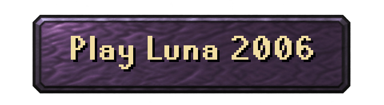
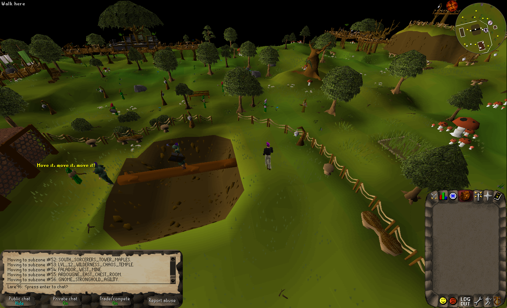

# Luna | Modified #377 Client

The official client that connects locally to the [Luna game server](https://github.com/luna-rs/luna). 

<p align="center">
<a href="https://luna2006.rs/"></a>
</p>

**Luna 2006** is an actively hosted 2006-era experience based on this project. Come see the
gameplay for yourself!

- 5x experience for players, 1x experience for bots
- Standard economy, no item spawns
- No character/economy wipes or resets



## Local development

Start a revision 377 server first. The default client connects to `127.0.0.1:43594`. [Luna server setup](https://github.com/luna-rs/luna/wiki/Getting-Started)

### Requirements

Use JDK 21. The browser preview also needs Node.js 24 and npm.

```powershell
git clone https://github.com/luna-rs/luna-client.git
cd luna-client
```

On Linux and macOS, use `./gradlew` in place of `.\gradlew.bat`.

### Supply a cache

You can find a cache in [releases](https://github.com/luna-rs/luna-client/releases) or on [OpenRS2](https://archive.openrs2.org/caches). Use a ZIP of the same cache as your server. It must contain `main_file_cache.dat`
and `main_file_cache.idx0` through `main_file_cache.idx4`. Replace the example ZIP
path below with yours.

### Desktop client

```powershell
.\gradlew.bat jar verifyClientJar "-PcacheZip=C:/path/to/cache.zip"
java -jar build/libs/luna-dev.jar
```

### Browser client

```powershell
npm --prefix browser ci
.\gradlew.bat :browser:browserSite "-PcacheZip=C:/path/to/cache.zip"
node browser/serve.mjs
```

Open the preview while your server is running. [http://127.0.0.1:8090/](http://127.0.0.1:8090/)

## Configuration

If your server uses custom settings, set its host, port, and public RSA values
in `client.properties` before building. [Configuration profiles](docs/UPSTREAM.md#configuration-profiles)

## Build verification and hosting

Run `.\gradlew.bat compileJava :browser:compileJava` to compile both clients
without a game cache. [Verification notes](docs/UPSTREAM.md#verification) · [Browser deployment](docs/DEPLOYMENT.md)

## Source layout and compatibility

- `src/`: shared Java client, game logic, packets, rendering and interfaces.
- `browser/src/main/java/`: browser entry point and platform adapters.
- `browser/web/`: browser page, input/presentation support and asset loading.
- `buildSrc/`: cache validation and preparation used by the build.
- `data/bootstrap/`: generated, ignored cache seed and integrity manifest.

This client targets revision 377 and is developed alongside the
[Luna server](https://github.com/luna-rs/luna). Other revision 377 servers need
compatible login encryption, packet handling and cache data; verify them with
your chosen server.