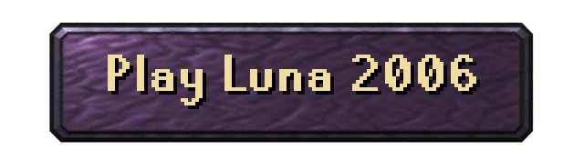
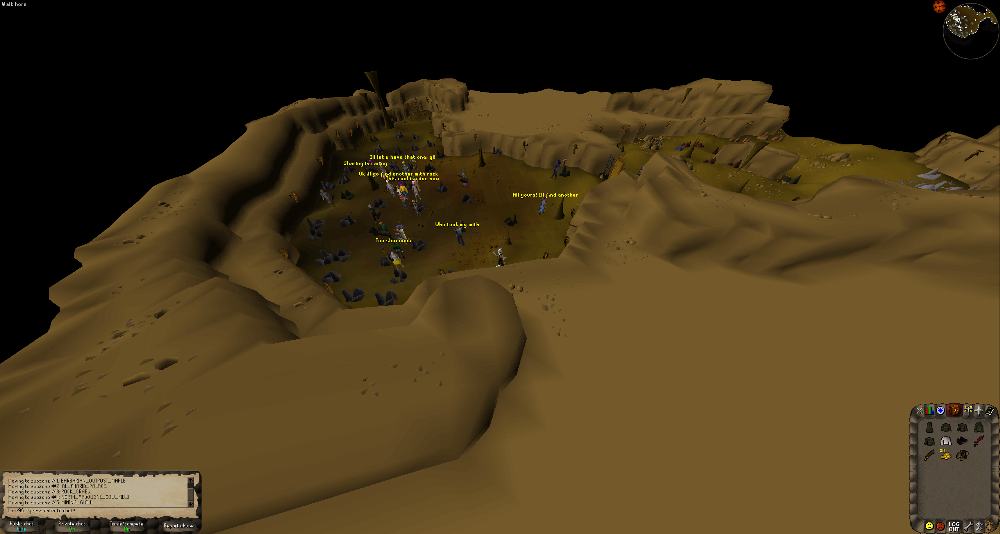

# Luna | Modified #377 Client

The official client that connects locally to the [Luna game server](https://github.com/luna-rs/luna). 

<p align="center">
<a href="https://luna2006.rs/"></a>
</p>

**Luna 2006** is an actively hosted 2006-era experience based on this project. Come see the
gameplay for yourself!

- 5x experience for players, 1x experience for bots
- No character/economy wipes or resets



## Local development

This public repository contains the shared revision 377 desktop and browser
client source. The default profile connects to your own local server at
`127.0.0.1:43594`. It does not connect to the hosted Luna 2006 game or a beta
server. Run a compatible server separately; starting the client does not start one.

### Requirements

- Java 21, including a JDK for building. Use the included Gradle wrapper.
- A compatible revision 377 server and its matching public RSA settings.
- Your own compatible cache ZIP for desktop or browser packaging.
- Node.js 24 and npm for the browser preview and website packaging tools.

Clone the repository and run commands from its root:

```powershell
git clone https://github.com/luna-rs/luna-client.git
cd luna-client
```

On Linux/macOS, use `./gradlew` instead of `.\gradlew.bat` and change the example
cache path to your local path.

### Supply a cache

Every packaging build requires `-PcacheZip=<path>`. The ZIP must contain one copy
of each core store:

```text
main_file_cache.dat
main_file_cache.idx0
main_file_cache.idx1
main_file_cache.idx2
main_file_cache.idx3
main_file_cache.idx4
```

The stores may be inside folders in the ZIP; unrelated files are ignored. The
build validates the stores, generates their SHA-256 manifest and prepares the
ignored `data/bootstrap/` directory for both clients. No cache is downloaded
automatically. Use a cache compatible with your server and client source.

### Desktop client

Edit the root `client.properties` to match your server, then build and verify the
executable JAR:

```powershell
.\gradlew.bat jar verifyClientJar "-PcacheZip=C:/path/to/cache.zip"
java -jar build/libs/luna-dev.jar
```

The output is `build/libs/luna-dev.jar`, which bundles settings and a cache seed.
When launched from this checkout, the root `client.properties` supplies settings.
A standalone JAR uses a matching settings file beside it when present, otherwise
its bundled defaults. Restart after changing desktop settings.

The default desktop cache is `${user.home}/luna/cache`, separate from the JAR and
settings. There is no beta JAR or beta connection profile in this public build.

### Browser client

Build the JavaScript and WebAssembly client and start the local preview:

```powershell
npm --prefix browser ci
.\gradlew.bat :browser:browserSite "-PcacheZip=C:/path/to/cache.zip"
node browser/serve.mjs
```

Open **http://127.0.0.1:8090/**. With the default profile, the preview's `/game`
WebSocket bridge forwards game traffic to `127.0.0.1:43594`. Your local game server
must be running there. Browser cache files are served from the built website and
retained in browser storage.

The browser and desktop share game logic, rendering and in-game interfaces,
including fixed and resizable modes. Browser adapters handle input, storage,
audio and networking.

## Configuration

Edit `client.properties` before building. Connection settings, branding, public
RSA values and browser settings all live in this file.

| Setting | Purpose |
| --- | --- |
| `clientName`, `websiteUrl` | Client title and Main Menu/project website link. |
| `connectHost`, `connectPort`, `portOffset` | Desktop TCP endpoint and local preview bridge target. The effective port is `connectPort + portOffset`. |
| `world`, `members`, `lowMemory` | World and client startup options. |
| `rsaEnabled`, `rsaModulus`, `rsaExponent` | Login encryption settings matching your server. Include only the public RSA key. |
| `cacheDirectory` | Desktop cache location; must end in `luna/cache`. |
| `clientSize`, `defaultWidth`, `defaultHeight` | Fixed (`0`) or resizable (`1`) mode and default resizable dimensions. |
| `websocketUrl` | Browser game endpoint. Defaults to `same-origin`, using `/game` on the local preview. |
| `webBindAddress`, `webPort` | Local preview listener; defaults to `127.0.0.1:8090`. |
| `webOrigin` | Exact website origin accepted by the optional Node proxy, without a path or trailing slash. |
| `websocketProxyPort` | Listener port for the optional standalone Node proxy. |

The browser can select another complete properties file in the repository root:

```powershell
.\gradlew.bat :browser:browserSite "-PclientProperties=custom.properties" "-PcacheZip=C:/path/to/cache.zip"
```

`-PclientProperties` selects the browser profile; the desktop JAR packages
`client.properties`. The browser's copied `client.properties` and generated
`client-config.json` are checked together for integrity. Rebuild after changing
the profile; do not edit generated connection settings.

Keep private RSA keys, credentials, deployment profiles, cache inputs and generated
packages out of public source control.

## Build verification and hosting

To compile shared desktop and browser source without supplying a cache:

```powershell
.\gradlew.bat compileJava :browser:compileJava
```

The **Compile development clients** GitHub Actions workflow runs these compile
checks on pushes to `master`, pull requests and manual dispatch. It does not
publish JARs, player launchers, cache downloads or a GitHub Pages site.

To build both clients and verify desktop packaging with your cache:

```powershell
.\gradlew.bat allClientBuilds verifyClientJar "-PcacheZip=C:/path/to/cache.zip"
```

See [verification notes](docs/UPSTREAM.md#verification) for the inherited regression
suite's local-fixture requirements. Compilation and packaging checks do not verify
a working game login.

To prepare your own browser website after building:

```powershell
node browser/build-webclient.mjs
```

The output is `build/webclient-site`; the destination must be new or empty. Deploy
it to your own HTTPS host with a working secure WebSocket endpoint. Static hosting
alone cannot forward traffic to a game TCP server. Use `same-origin` with your own
same-host `/game` proxy, or configure an absolute `wss://.../game` endpoint. Configure
the server to accept the website's exact origin and match its public RSA settings.

See the [deployment guide](docs/DEPLOYMENT.md) for hosting examples and
[shared maintenance](docs/UPSTREAM.md) for the source boundary and fork updates.
Deployment examples describe infrastructure you supply; they are not an active
public deployment of this repository.

## Source layout and compatibility

- `src/`: shared Java client, game logic, packets, rendering and interfaces.
- `browser/src/main/java/`: browser entry point and platform adapters.
- `browser/web/`: browser page, input/presentation support and asset loading.
- `buildSrc/`: cache validation and preparation used by the build.
- `data/bootstrap/`: generated, ignored cache seed and integrity manifest.

This client targets revision 377 and is developed alongside the
[Luna server](https://github.com/luna-rs/luna). Other revision 377 servers need
compatible login encryption, packet handling and cache data; verify them with
your chosen server.

See [third-party notices](browser/web/legal/THIRD_PARTY_NOTICES.txt) for component
licenses and asset provenance. These notices do not assign a blanket license to
the inherited client or game assets. The original desktop README is retained in
[DESKTOP-UPSTREAM.md](docs/DESKTOP-UPSTREAM.md).
